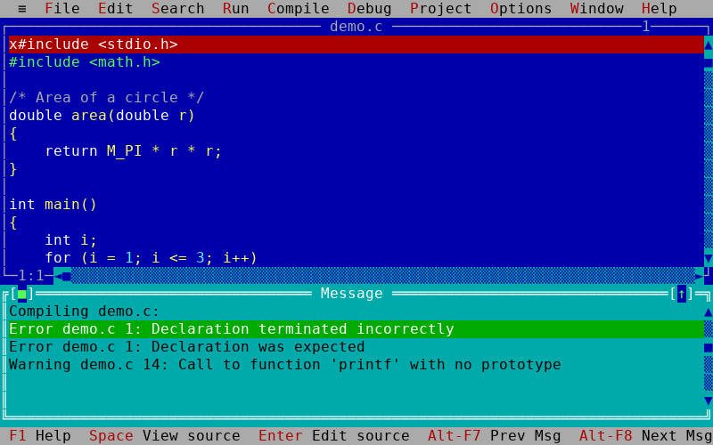
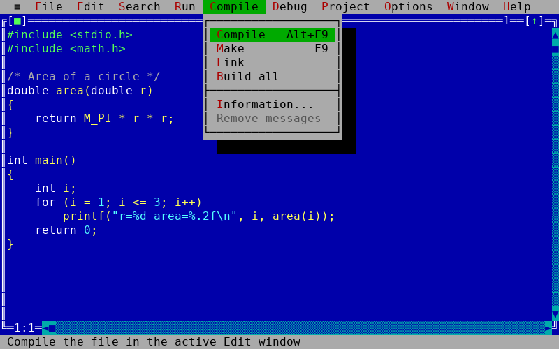
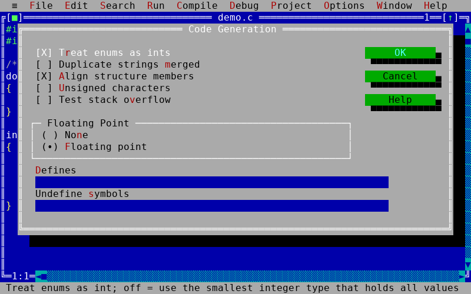
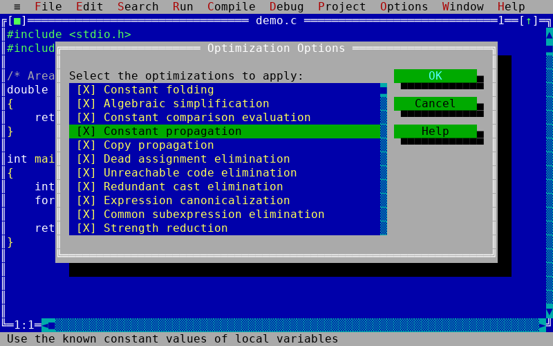
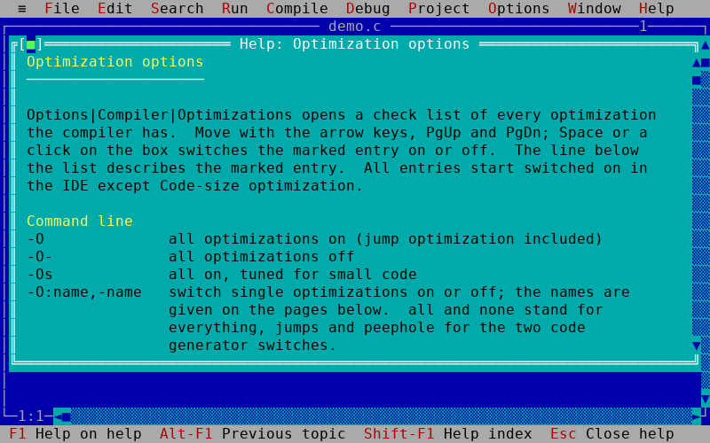
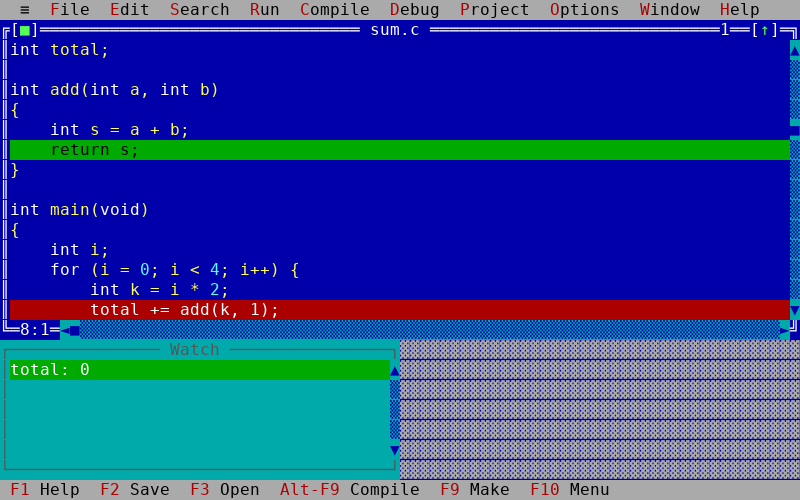
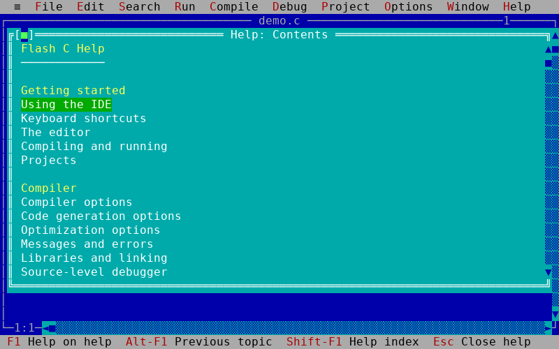

# Flash C

A small C compiler and a full-screen, text-mode IDE for Linux.

* **`fcc`** is the command-line compiler. It reads C source and writes a native **x86-64 Linux
  executable** directly: no assembler, linker or C library is involved.
* **`fc`** is the IDE: pull-down menus, overlapping edit windows, an error Message window, option
  dialogs, a source-level debugger and hyper-linked online help, laid out like the classic DOS-era
  C IDEs.


Flash C compiles **C (ANSI C89)** with a few C99 conveniences. C++ is not supported.

## Highlights

* **Complete toolchain in one place.** Editor, compiler, linker, run-time library, debugger and help
  are all part of the project.
* **A real optimizer.** 48 switchable optimizations: constant folding, global data-flow analysis,
  SSA, inlining, loop optimizations, register allocation, whole-program passes and profile-guided
  optimization. See [Optimizations](docs/COMPILER.md#5-optimizations).
* **Source-level debugger** with breakpoints, watches, an expression evaluator and call stack.
* **Per-function linking.** Only the library functions your program uses end up in the executable.
* **Classic diagnostics.** `Error hello.c 5: Undefined symbol 'x' in function main`.
* **Online help** for the IDE, the language and every library function, with examples you can copy
  into the editor.

## Quick start

**Install a release (Linux x86-64):** download `flash-c-<version>-linux-x86_64.tar.gz` from the
[Releases](../../releases) page, then

```
tar xzf flash-c-*.tar.gz
cd flash-c-*/
./install.sh              # installs to ~/.local; use --prefix DIR or run as root for /usr/local
```

`./install.sh --uninstall` removes it again. Installing is optional: the unpacked folder also runs
in place with `./bin/fc` and `./bin/fcc`. See [releasing](docs/RELEASING.md) for how releases are made.

**Build from source:** you need a C compiler (gcc or clang), `make`, and a terminal of at least 80×25 with UTF-8. 24-bit
colour is used when `COLORTERM=truecolor`; otherwise 16 ANSI colours.

```
make                      # builds build/fc and build/fcc
./build/fc hello.c        # open (or create) hello.c in the IDE
./build/fcc hello.c       # or compile it directly; this produces ./hello
./hello
```

`make test` runs the whole test suite, and `make install` copies both programs and the help files
to `/usr/local`.

In the IDE, type a program and press **F2** to save, **F9** to build and **Ctrl+F9** to run it. If
the build fails, the Message window lists the errors; press **Enter** on one to jump to the line.
[The user guide](docs/USER_GUIDE.md) has the details.

## A quick tour

**Errors that take you to the line.** The Message window lists errors and warnings; the cursor
follows them with Alt+F7 and Alt+F8.



**Menus and dialogs.** Every command is in the menus, with a one-line hint on the status line. The
Options dialogs hold the compiler, linker and environment settings.

| | |
|---|---|
|  |  |

**Optimizations.** Each optimization has its own check box, with a description on the status line.
The Help button opens the matching help page.

| | |
|---|---|
|  |  |

**Debugger.** Set breakpoints with Ctrl+F8, step with F7 and F8, and watch values change.



**Help.** F1 opens the contents; Ctrl+F1 shows the topic for the word under the cursor, for example
`printf`.



## Documentation

| Document | What is in it |
|---|---|
| [User guide](docs/USER_GUIDE.md) | Using the IDE: windows, menus, keys, the editor, projects, the debugger, online help. |
| [Compiler reference](docs/COMPILER.md) | `fcc` switches, the language Flash C accepts, diagnostics, optimizations, profile-guided optimization, linking. |
| [Library reference](docs/LIBRARY.md) | Every header and function of the run-time library, with the module that implements it. |
| [Architecture notes](docs/ARCHITECTURE.md) | How the compiler, optimizer, library, IDE and debugger work inside; for contributors. |
| [Evidence](analysis/EVIDENCE.md) | How the IDE structure was derived from a study of the reference IDE. |

## Project layout

```
src/compiler/   lexer and preprocessor, parser and type checker, optimizer, x86-64 code generator
                and ELF writer, compiler driver
src/ide/        terminal layer, windows, menus, dialogs, editor, help, debugger, commands
src/cli/        the fcc main program
runtime/        the run-time library in Flash C (lib/) and its headers (include/)
help/           the extended online help (*.fch), generated by tools/helpgen
tests/          compiler, diagnostics, optimizer, library, IDE and debugger tests
tools/          generators (library docs, help files, screenshots) and development helpers
docs/           the documentation, and the screenshots used in it
analysis/       the study of the reference IDE
```

## Contributing

Bug reports and pull requests are welcome; see [CONTRIBUTING.md](CONTRIBUTING.md) for the workflow,
code style and tests.

## Tests

`make test` runs, in order: the compiler against `gcc` (`tests/run.sh`), the diagnostics text
(`diag.sh`), the command-line switches (`options.sh`), each optimization (`opt.sh`) and a fuzz
test that compiles random programs with and without optimization and compares their output
(`optfuzz.py`), the help examples (`helpexamples.py`), the library (`libtest.sh`), and the IDE,
projects and debugger driven through a pseudo-terminal (`ide_smoke.py`, `project_smoke.py`,
`debug_smoke.py`).

The screenshots in this repository are made by the real IDE: run `python3 tools/screenshots.py`
after a build to regenerate them.

## Notice on the reference product

This project uses Turbo C (TC) only as a reference. It does not use any of its resources: no code,
libraries, headers, help text or other files from it are included. All of the compiler code and
the standard library source in this repository is original, generated code. The compiler and the IDE
were developed by studying the executable binary of the Turbo C++ compiler, available at
<https://archive.org/details/turboc3.1_202112>. The IDE structure (menu tables, dialog controls,
status line, colour groups, compile, make and run behaviour) was derived from that study; the
evidence and method are in [`analysis/EVIDENCE.md`](analysis/EVIDENCE.md). The raw extraction output
is not distributed with this repository.

## License

Flash C is released under the [MIT License](LICENSE).
