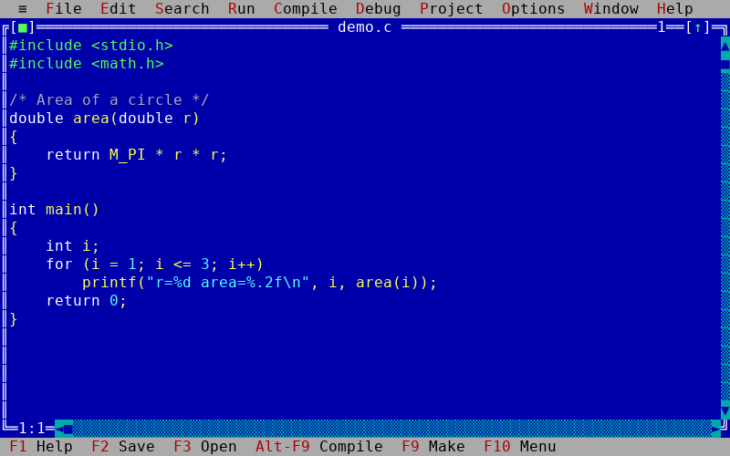

# Flash C

A small C compiler and a full-screen text-mode IDE for Linux.

* **`fcc`** – command-line compiler. Reads C source and writes a native **x86-64 Linux
  executable** directly (no assembler, linker or C library involved).
* **`fc`** – the IDE: pull-down menus, overlapping edit windows, Message window with error
  tracking, option dialogs, online help – laid out like the classic DOS-era C IDEs.

Flash C compiles **C (ANSI C89) only**. C++ is not supported, and the IDE has no C++ options.



The IDE structure (menu tables, dialog controls, status line, colour groups, compile/make/run
behaviour) was derived from a static analysis of the reference IDE binaries in
`research/TC`. The evidence and method are written up in
[`analysis/EVIDENCE.md`](analysis/EVIDENCE.md). The raw extraction output is not distributed with
this repository.

## Notice on the reference product

This project uses Turbo C (TC) only as a reference. It does not use any of its resources: no code,
libraries, headers, help text or other files from it are included. All of the compiler code and
the standard library source in this repository is original, generated code. The compiler and the IDE
were developed by studying the executable binary of the Turbo C++ compiler, available at
<https://archive.org/details/turboc3.1_202112>.

## Build and run

Requirements: a C compiler (gcc/clang), `make`, a terminal of at least 80×25 with UTF-8.
24-bit colour is used when `COLORTERM=truecolor`; otherwise 16 ANSI colours.

```
make                    # builds build/fc and build/fcc
./build/fc hello.c      # IDE (several files / a project.fcp may be given)
./build/fcc hello.c     # compiler only:  produces ./hello
./hello
make test               # compiler tests, diagnostics tests, IDE end-to-end test
```

`make install` copies both programs to `/usr/local/bin`.

## Using the IDE

| Key | Action | Key | Action |
|---|---|---|---|
| F10 / Alt+letter | menu bar | F3 / F2 | open / save |
| Alt+F9 | compile | F9 | make |
| Ctrl+F9 | run | Alt+F5 | user screen (program output) |
| Alt+F7 / Alt+F8 | previous / next error | F6 / F5 | next window / zoom |
| Alt+F3 | close window | Alt+0 | window list |
| F1 | help | Ctrl+F1 | help on word at cursor (e.g. a library function) |
| Alt+X | quit | Alt+Backspace | undo |

Editor commands include the classic block commands (`Ctrl-K B/K/C/V/Y/R/W`), quick
commands (`Ctrl-Q …`), `Shift+arrows` selection, `Ctrl+Ins / Shift+Ins / Shift+Del`
clipboard, regular-expression find/replace, syntax highlighting, auto-indent and the mouse
(menus, window drag/resize/zoom/close, scroll bars, text selection).

Typical session: **F10 → File → New**, type a program, **F2** to save, **F9** to build.
Errors open the *Message* window; **Enter** on a message jumps to the source line. **Ctrl+F9**
runs the program on the normal terminal screen (your terminal's scroll-back keeps the output;
**Alt+F5** shows it again).

Menus not mentioned above: Project (multi-file programs, `.fcp` project files), Options
(compiler, linker, environment, colours, directories – saved with *Options → Save* in
`fcconfig.fc`), Window (tile, cascade, size/move, Message/Output/Watch windows).
Some terminals reserve a few function-key combinations; every command is reachable from the
menus.

## The language

Flash C implements the C89 language as used by DOS-era compilers, plus a few C99
conveniences (declarations anywhere in a block, `//` comments, designated initialisers).

* Types: `char short int long` (+`unsigned`), `float`, `double`, pointers, arrays, `struct`,
  `union`, `enum`, `typedef`, function pointers. **`int` is 32 bits, `long` and pointers are
  64 bits** (the target is x86-64, so the 16-bit DOS `int` does not apply).
* Statements/operators: everything in C89, including `switch`, `goto`, `?:`, comma, all compound
  assignments, pointer arithmetic and `sizeof`.
* Preprocessor: `#include` (user, `<…>` and built-in headers), `#define` (object- and
  function-like, `#`, `##`, `__FILE__`, `__LINE__`), `#if/#ifdef/#ifndef/#elif/#else/#endif`,
  `#undef`, `#error`, `#pragma startup/exit` (other pragmas are ignored).
* Keywords `near`, `far`, `huge`, `cdecl`, `pascal`, `interrupt` are accepted and ignored.

Whole `struct`s can be passed to and returned from functions by value.

**Bit-fields** follow C89: members declared `int`, `signed int` or `unsigned int` with a constant
width of 1 to 32 bits (`unsigned flag : 1;`), unnamed fields (`int : 3;`) and `: 0` to start a new
unit. Fields are packed from the least significant bit into 32-bit units and never straddle a unit; a
plain `int` field is signed. Fields can be read, assigned, used with `++`/`--`/`op=`, initialised in
brace initialisers, copied with their struct and shown by the debugger. Taking their address or
applying `sizeof` is an error, as are `char`, `short` and `long` fields.

**Other C89 details.** Trigraphs (`??(` ...) are replaced before lexing; wide characters and strings
(`L'a'`, `L"text"`, `wchar_t` is a 32-bit `int`) are supported; `__DATE__`, `__TIME__`, `__FILE__`,
`__LINE__` and `__STDC__` are predefined; `#include` accepts a macro that expands to a header name.
`const` is checked for scalars, pointers and arrays (`Cannot modify a const object`); it is not
tracked for whole `struct`/`union` objects (their `const` members are). Calls through a prototype
reject pointer/integer mismatches (`Type mismatch in parameter N in call to 'f'`), objects of an
incomplete struct type, a repeated `typedef`, `register` at file scope and floating point in `#if`
are errors.

**Not implemented yet:** compound
literals, variable-length arrays, `long long` as a distinct type (it is `long`), `long double`
(it is `double`).

### Source-level debugger

Flash C has a source-level debugger built into the IDE (the feature set follows the evidence in
[`analysis/EVIDENCE.md`](analysis/EVIDENCE.md) §7). The compiler records line, function, variable and type
information when *Options|Debugger|Source debugging* is *On* (or `fcc -v`); the IDE then runs the
program under `ptrace`:

| Command | Key | What it does |
|---|---|---|
| Run | Ctrl+F9 | runs to the next breakpoint (or the end) |
| Program reset | Ctrl+F2 | ends the debug session |
| Go to cursor | F4 | runs to the line under the cursor |
| Trace into | F7 | executes the next statement, entering user functions |
| Step over | F8 | executes the next statement, calls included |
| Toggle breakpoint | Ctrl+F8 | sets or clears a breakpoint (red line) |
| Breakpoints... | | list, edit (condition, pass count, file, line), delete, view, set at a function |
| Evaluate/modify... | Ctrl+F4 | evaluates a C expression, assigns a new value |
| Inspect... | Alt+F4 | inspects structures, arrays and pointers; modify elements; range inspect |
| Call stack... | Ctrl+F3 | functions that led here, with arguments; selects the frame used for evaluation |
| Watches | Ctrl+F7 | live values in the Watch window |
| Window|Register | | CPU registers of the stopped program |

The current statement is shown with a green bar. Expressions understand locals, globals, `.`, `->`,
`[]`, `*`, `&`, casts, `sizeof`, assignment and a `,x` `,d` `,c` format suffix. The program's output
goes to the user screen (Alt+F5); *Options|Debugger|Display swapping* controls when it is shown
during a step. Breakpoints are saved in `fcdef.dsk` with *Options|Environment|Desktop*.
Limits: the debugger does not call functions from expressions; there is no reverse execution.

### Library

Flash C ships a complete standard run-time library modelled on the structure of a classic DOS C
library (see [`docs/LIBRARY.md`](docs/LIBRARY.md) for every function, header and module). It is
written in Flash C itself (`runtime/lib/`), embedded into the compiler, and **linked per function**:
only what your program (transitively) uses ends up in the executable.

| Part | Source | Contents |
|---|---|---|
| Start-up | `runtime/lib/c0.c` | entry point, `argc/argv/environ`, `atexit`, `exit/_exit/_cexit/abort`, `#pragma startup/exit` runner |
| Standard library | `runtime/lib/c/*.c` | stdio, string/mem, ctype, stdlib (heap, `qsort`, `rand`, conversions), time, signal, setjmp, io (descriptors, `stat`), dir (`findfirst`, paths), process (`system`, `spawn*`, `exec*`), conio (ANSI console), dos/bios helpers, locale, assert |
| Math library | `runtime/lib/m/*.c` | `math.h` (with the classic `matherr` messages), `%e %f %g` and `strtod/atof/ecvt/fcvt/gcvt`, `_control87` family |
| Wildcard arguments | `runtime/lib/wildargs.c` | optional: expands `*` and `?` in the command line (`wildargs.obj`) |

Public headers: `alloc assert bios conio ctype dir direct dirent dos errno fcntl float io limits locale
malloc math mem memory process search setjmp share signal stdarg stddef stdbool stdio stdlib string
time utime values varargs locking`, and `sys/stat sys/timeb sys/types`.

How it works, in the same spirit as a classic linker setup:

* **Floating point is optional.** A program that never uses `float`/`double` does not link the
  conversion code; if `printf("%f")` runs without it the program stops with
  `printf : floating point formats not linked` (as the original library does). Using `float` or
  `double` pulls the math library in automatically.
* **`#pragma startup fn [priority]` / `#pragma exit fn [priority]`** run `fn` before `main` /
  after it returns (priority 0-255, default 100; start-up ascending, exit descending). The
  library itself uses this to flush `stdio` and to register the floating-point converters.
* **Link map:** `-M` writes `<output>.map` with the segments, `-Mp` adds public symbols and
  `-Md` the detailed segment map; each symbol is attributed to its library module.
* **Selecting libraries:** `-ln` links no libraries (only the start-up code), `-lnm` omits the math
  library, `-f-` selects "no floating point", and `wildargs.obj` as an extra file enables wildcard
  arguments. In the IDE these are *Options -> Linker*, *Options -> Libraries* and
  *Options -> Compiler -> Code generation -> Floating point*.
* The library is an **ordinary C library for Linux x86-64** underneath: files are real file
  descriptors, `conio` writes ANSI sequences, `time` honours `TZ`, `signal` uses kernel signals,
  `system/spawn/exec` use `fork/execve`. DOS-only facilities (BIOS, ports, interrupts, far/overlay
  memory, `gettext/puttext/movetext`, graphics) are intentionally absent.

Your own include directories (*Options -> Directories* or `-I`) are searched before the built-in
headers. `printf` and `strtod` are exact (correctly rounded, half-to-even) and match glibc in the
regression tests; `rand()` uses the classic generator, so `srand(1)` yields 346, 130, 10982, ...

## Compiler command line

```
fcc [options] file.c [file2.c ...]     * several files are compiled as one program
  -Dname[=value]  define macro         -Idir     include directory
  -C              nested comments      -K        char is unsigned
  -w / -w-        all / no warnings    -w-use -w-pro -w-ret -w-par   individual warnings
  -jN  -gN        stop after N errors / warnings        -iN  identifier length
  -ename          output file name
  -M -Mp -Md      link map (segments / + publics / detailed)
  -ln  -lnm       no libraries / no math library      -f-  -f  -f87   floating-point mode
  wildargs.obj    (as a file name) link the wildcard argument expander

  -b- / -b        enums use the smallest fitting integer type / always int (default)
  -d              merge identical string literals     -a-  pack structure members (no padding)
  -N              test for stack overflow on function entry ("Stack overflow!", exit code 1)
  -O / -O-        all optimizations on / off (jump optimization plus the tree optimizations)
  -O:name,-name   single optimizations: fold algebra compare constprop copyprop deadstore
                  unreachable casts canon cse strength bool  cfg gconst ccp cfs ublock gdce
                  gcopy merge thread live branch tailrec  jumps peephole all none
  -Z              suppress redundant loads (constant operands stay in a register)
  -A              ANSI keywords only: no // comments, near/far/huge/cdecl/pascal/interrupt are identifiers
  -Uname          undefine a macro
  -ls<KB>         stack size (setrlimit at start-up; also the -N limit)   -lt  ELF symbol table
  -lw             separate R+X code and R+W data segments (no RWX segment)
  -wrch -wamb -wstv -wcln -wucp -wcpt -wsus   individual warnings (unreachable code, ambiguous
                  operators, structure by value, constant condition, char pointer signedness,
                  pointer comparison, suspicious pointer); -w-xxx turns one off
```

Each switch has a matching check box in *Options → Compiler / Linker* (Code generation,
Optimizations, Source, Messages, Linker). They are modelled on the switches of the reference
compiler (`-b -d -a -N -O -Z -A -U`); the ones that only make sense for 16-bit DOS (memory models,
Pascal calls, overlays, segment names, instruction sets, register variables) are not offered.
`tests/options.sh` checks them.

Diagnostics use the classic format: `Error hello.c 5: Undefined symbol 'x' in function main`,
`Warning …`, `Linker Error: Undefined symbol _foo in module …`.

## Source layout

```
src/compiler/   lexer + preprocessor (cpp.c), parser/type checker (parse.c),
                x86-64 code generator + ELF writer (gen.c), driver (compile.c)
src/ide/        terminal layer (term.c), windows/menus/dialogs (wm.c menu.c dialog.c),
                editor (editor.c buf.c), option dialogs (dialogs.c), help (help.c), commands (ide.c)
src/cli/        fcc main program
runtime/        lib/ (c0.c start-up, c/ standard library, m/ math library, wildargs.c) and include/*.h (headers)
tests/          run.sh (compiler vs gcc), diag.sh (message text), libtest.sh (library options), ide_smoke.py (IDE)
analysis/       EVIDENCE.md + extract_evidence.py  (study of the reference IDE)
docs/           ARCHITECTURE.md, LIBRARY.md (generated by tools/gen_libdoc.py), screenshots/
```

More detail: [`docs/ARCHITECTURE.md`](docs/ARCHITECTURE.md).

## License

Flash C is released under the [MIT License](LICENSE).

## Online help

F1 opens hyper-linked help; Ctrl+F1 shows the topic for the word under the cursor (for example
`printf`), Shift+F1 opens a searchable Index, Alt+F1 goes back. The reference for every standard
library function (syntax, header, return value, examples that Edit|Copy example puts in the editor)
is read from external files in `help/*.fch` (installed to `$PREFIX/share/flashc/help`; override with
`FC_HELP=dir`). Without those files only the basic built-in documentation is shown.

The C language has its own topics too (`help/language.fch`, start at *Language topics*): every keyword
(`while`, `struct`, `static` ...), the operators, constants, declarations, functions, pointers, arrays,
bit fields, type conversions and each preprocessor directive (`#include`, `#define`, `#if` ...), each with
syntax, notes and a small program. Ctrl+F1 on a keyword in the editor opens its topic. Both help files are
generated by `make help` from `tools/helpgen/`; `tests/helpexamples.py` compiles and runs all the examples.
